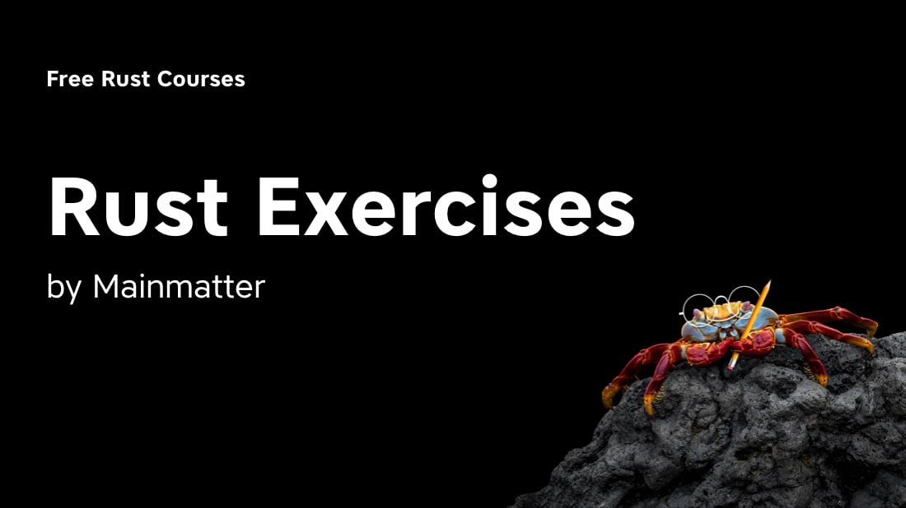

[*100 Exercises to Learn Rust*](https://rust-exercises.com/100-exercises/) by
Luca Palmieri was easily the most effective, hands-on resource I encountered
while learning Rust. While *Rustlings* has its place for drilling isolated
compiler errors, its exercises often feel too trivial and fragmented to build
genuine architectural intuition. Luca's course, by contrast, anchors the
language mechanics to a continuous, realistic project that forces you to
grapple with how Rust features fit together in practice. (Working through it in
RustRover with inline AI completion turned off also kept me honest, since I
had to actually reason through every borrow-checker error myself.)

The running project, building a ticket management system, was great motivation.
Virtually every software developer has professional experience living inside
ticket trackers, making the problem domain immediately intuitive without
requiring any domain onboarding. We certainly didn't build Jira; the domain
model stayed intentionally lean with titles, descriptions, IDs, and statuses.
That lightweight scope was an asset rather than a drawback: it gave just enough
structural meat to naturally motivate constructor validation, state transitions,
collection trade-offs (`Vec` to `HashMap` to `BTreeMap`), `Index` and `IndexMut`
mechanics, and eventually multi-threaded client-server channels without getting
bogged down in domain trivia.

I know Luca also has a dedicated _Build Your Own Jira with Rust_ workshop, and I
wonder if that repository builds out a more fully functional system. Given how
clean and approachable his explanations and architectural style are, it's
definitely something I want to skim on GitHub.

Where this resource really shines is as a companion to
[_The Rust Programming Language_ (TRPL)](https://rust-book.cs.brown.edu). TRPL
is indispensable for theory and foundational language semantics, but it is
theory-heavy and its hands-on projects are sparse. _100 Exercises_ fills that
exact void. It bridges the gap between reading about ownership and actually
fighting the borrow checker across thread boundaries, interior mutability
(`RefCell`, `Mutex`, `RwLock`), and scoped threads.

Chapter 7 (Threads) was the highlight of the second half, even if its ending
felt a little anti-climactic: after spending nearly the entire chapter building
out a channel-based client/server architecture, the final exercise swaps it out
entirely for `Arc<RwLock<TicketStore>>`. In Go or Elixir, the channel
implementation would have been the final word, so pivoting to locks at the last
minute felt abrupt, and we barely got to spend any time with that final
concurrent design before moving on. Still, it drove home an important Rust
distinction: because `Send` and `Sync` guarantee data-race freedom at compile
time, `Arc<RwLock<T>>` is often the cleaner, lower-overhead choice for shared
in-memory state, leaving channels for work queues and decoupled tasks.

Chapter 8 (Futures), by comparison, felt much thinner. Instead of continuing to
evolve `TicketStore`, it drops down to small, contrived `TcpListener` echo
examples (even looping back to threads via `spawn_blocking`), and leaves async
primitives like `Semaphore` and `tokio::sync` channels as concepts rather than
real exercises. You come away with the core mental model (`Future` state
machines, `Send` across `.await` yield points, async-aware locks, and
cancellation), but not much muscle memory.

The book wraps up with a Final Challenge to put an HTTP API in front of the
ticket store. I really liked that Luca provided the spec as a `requests.http`
file rather than rigid unit tests, because it gives you a clear contract while
leaving the implementation completely open. Rather than guessing my way through
`axum`, `serde`, and `tokio` all at once, though, I'm shelving the Final
Challenge for now and heading straight into Luca's _Zero to Production in Rust_.
Once I have a proper foundation in Tokio and Rust web services, I'll come back
and tackle it from a place of knowledge rather than trial and error.

Full
[book notes](https://github.com/llcawthorne/book-notes/blob/main/rust/100-exercises/book-notes.md).
