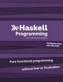

*Haskell Programming from First Principles* by Chris Allen and Julie Moronuki,
better known as *The Haskell Book*, is a massive book. My copy runs around 1,200
pages, and I worked through all of it, exercises and all, minus a few at the
very end. This was actually my second attempt. The first time I fell off
somewhere around page 300, since the pace was slow and nothing in the book had
me building things, so I lost momentum. This time I paired it with *Learn
Haskell by Example* for projects and *Learn You a Haskell* as light reading on
the side, and that combination is what got me through, with *The Haskell Book*
building up the theory and *Learn Haskell by Example* giving me a wide variety
of places to apply it.

The explanations are excellent, if somewhat longwinded, and the book is really
good at taking complicated concepts and making them understandable. It's slow,
and in the early chapters on types and type classes it's almost mind-numbingly
slow, since those concepts are fairly straightforward, but the slow style pays
off once you hit the stuff that's actually hard. Folding is a good example. Most
books show you how to sum a list with a fold, maybe implement `map` and `filter`
with one, and call folding a learned concept. *The Haskell Book* gives it 40
solid pages, which is kind of a big deal if you come from a language where you'd
normally just reach for a while loop.

The type class chapters were the best part of the book for me. Semigroup,
Monoid, Functor, Applicative, Monad, Foldable, and Traversable each get a full
treatment, laws included, and you write a lot of instances yourself. It was the
first resource I'd read that pressed hard on the monoidal part of Applicative.
*Advanced Functional Programming with Elixir* had already shown me `ap`
collecting all your validation errors instead of stopping at the first one, but
it never pointed out that the collecting comes from the monoidal side of
Applicative, combining the structures themselves rather than just applying
functions inside them, so I didn't really understand why it worked. That's the
piece that made `Validation` finally make sense to me.

By the end, "follow the types" had become my main problem-solving strategy. Most
of the time, once I figured out what the types required, there was only one
sensible thing I could write that would compile. It sometimes felt a bit like
quantum mechanics, where I could trust the equations the same way I trust the
types, even when I wasn't totally sure what it all *meant*. The book also cites
research papers, which is unusual for an introductory programming book (*Head
First Go* sure didn't point me at any current research). It's a quirk of the
Haskell community, and while I'm not sure I'll ever make it through Wadler '89,
I appreciated the pointers.

There are a lot of exercises, more than in any other programming book I've read.
They normally reach a little past what the chapter covered, but I could work
through everything except maybe a challenge problem at the end without needing
help. Some were just typing practice, since once you've written a Semigroup
instance for `Two a b`, `Three a b c` and `Four a b c d` don't teach you
anything new. Others were genuinely hard, like writing a Semigroup for a type
that wraps a function, which took my whole reading session.

My biggest complaint is that, for all the time it spends explaining concepts,
the book is pretty light on using them in anger. I came out of the Monad and
Transformers chapters knowing how to build a monad or a transformer from
scratch, but without much sense of how to use them in a real program. I even had
to write `StateT` myself as an exercise, supposedly the most obnoxious of the
standard transformers, without ever seeing much of it in action, so *Learn
Haskell by Example* is where I'm going to get that practice.

Testing follows a similar pattern. The testing chapter is solid, it covers
`hspec` and QuickCheck, explains generators well (including the difference
between product and sum types), and points you to a real project to see tests in
the wild, and the book goes on to reuse QuickCheck and `checkers` to test the
type class laws, which is great. But it mostly used tests to show off `checkers`
for testing laws and never really embraced testing ordinary, run-of-the-mill
code. There were no tests for roughly the last ten chapters, and none in the
final project, and it isn't much of a project without tests.

The Parsers chapter was the big outlier. I understood all of the material as it
was presented, it just wasn't an adequate build-up to the exercises: "Here's how
to parse a char. Cool, now figure out a log file." It used `<|>` in an exercise
several pages before introducing it, told you to "try `try`" without explaining
it, and introduced tokenization mostly through examples of doing it wrong. Then
it asked for a SemVer parser, IPv4 and IPv6 parsers, and a parser for Graphviz's
DOT language, and that chapter took me about a week.

Quality control seems to slip a bit as you go, too. Somewhere past page 900 the
explanations got thinner. The JSON section switched examples halfway through and
barely spent time on either, so I've seen `aeson` parse JSON, but I wouldn't say
I'm ready to use it. The exceptions chapter was all toy examples, never
mentioned `bracket` or `finally`, and used catching `SomeException` as an
example. The Composing Types chapter opened with a "warmup" that had me write
the Applicative instance for `Compose`, and that was anything but a warmup. I
also found a handful of errata. The State chapter has `runState f >> f 0` where
it needs parentheses. The book claims `zipWith` is just `liftA2` specialized to
lists, then immediately shows them producing different results. One Applicative
exercise looks like it's setting you up to produce `Just 11` but can only ever
produce `Just 5`. And it has you name constructors `Success` and `Failure` right
after telling you to import QuickCheck, which already exports both.

The book is about ten years old, and you'll feel it. The original project files
pin GHC 8.6.5, which doesn't even exist for Apple Silicon, the `checkers` tuple
shapes for testing Traversable had changed, an old version of `trifecta` wanted
a decade-old set of dependencies, and the final project uses `network` functions
that have since been renamed, so I spent a fair amount of time fighting
dependencies. I don't hold version drift against a ten-year-old book, though,
just expect to update some resolvers and function names as you go. The Basic
Libraries chapter was like a museum trip, but most of the exhibits are still
alive.

The final project is a finger daemon backed by SQLite. Honestly, it didn't feel
like much of a final project, since I mostly typed in the code from the book,
but most of the prose explaining it felt unnecessary, which tells me the book
did a good job preparing me, and it could have just been a code listing. The
exercises at the end go from "use the `sqlite3` CLI to add a user" to "build a
control socket on another port while the server runs," which is basically "go
read Marlow's book on concurrency and come back to this project." I skipped
straight to the last step: celebrate completing this massive book.

Overall, *The Haskell Book* is the best resource I've found for actually
understanding Haskell. If you want to know why Applicative works the way it
does, or what the Functor laws are for, this is the book. Just don't expect it
to teach you to build things. It's light on putting its concepts to work, it
drops testing for the last third, and the later chapters have a lot less polish
than the early ones, so I wouldn't have finished it without a project book
alongside it. With one, it was well worth the 1,200 pages.

Full [book notes](https://github.com/llcawthorne/book-notes/blob/main/haskell/the-haskell-book/book-notes.md).
