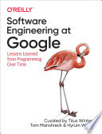

At over 23 hours, this was a massive audiobook, but I think it's one of the
better books of software engineering advice I've read. The core framing is that
programming is just the immediate act of producing code, while software
engineering is what you have to do to keep that code sustainable over time and
across a team, or as they put it, it's programming if clever is a compliment and
software engineering if clever is an accusation. Hyrum Wright is one of the
co-authors, and you can tell he's proud of Hyrum's Law since it gets cited at
least three times. It's a solid observation though: with enough users, every
observable quirk of your system becomes a contract someone depends on, and while
Google obviously sees that at an extreme scale, I've seen it crop up even in my
own smaller applications.

While it's true that not everyone works at the scale of Google or has the same
need for code longevity, they tend to point out when their considerations are
primarily scale-driven, and they share a lot of hard-won advice. They don't shy
away from making lessons out of where they've made mistakes either, offering
several case studies where they openly admit they wish they had handled things
better. A huge chunk of the book is about testing, and I really liked their
emphasis on testing public behavior and outcomes rather than implementation
details. They lean heavily toward using real dependencies or high-fidelity fakes
instead of mocking everything out, which matches my own experience with
mock-heavy tests becoming brittle and useless.

The chapters on Google’s internal tooling were interesting too, even if most of
us don't have the luxury of having thousands of software engineers around to
develop custom build systems, code search tools, and entire languages just to
support our core products. Still, their arguments for simple trunk-based
development, short-lived branches, and relying on fast rollbacks rather than
fear of releasing felt grounded in reality.

Since this was another audiobook, my notes aren't quite as filled out as normal,
since I mostly just try to jot down core ideas when I'm listening on a run.
There were plenty of good observations in here that I didn't get down, but I
think I managed to capture the main points that really struck me. It's a long
listen, but well worth the time.

Full [book notes](https://github.com/llcawthorne/book-notes/blob/main/architecture/software-engineering-at-google/book-notes.md).
