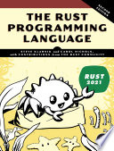

I just wrapped up *The Rust Programming Language*, specifically the
[Brown University interactive version](https://rust-book.cs.brown.edu), and the
sheer volume of notes I ended up taking says a lot about how much substance is
packed into it. It isn't often that an introductory language book doubles as a
long-term reference you know you'll keep returning to, but this one definitely
earns that spot, and I think it's easily the best starting point for anyone
serious about learning Rust.

The biggest strength of the book is how directly and thoroughly it tackles the
genuinely hard parts of the language. It doesn't hand-wave ownership, borrowing,
lifetimes, trait objects, or smart pointers. Instead of giving you a quick
overview and leaving you to battle the compiler on your own, it takes the time
to build a clear mental model of how the language manages memory. By the time I
finished the final chapters on concurrency, async, and building the
multi-threaded web server project, I felt completely comfortable moving on to
more hands-on, project-driven material.

If there's any real annoyance, it's that the authors explain almost everything
from first principles, which means if you already have experience in other
languages, you'll spend some time skimming through exhaustive explanations of
elementary concepts that feel pretty self-explanatory. They definitely go into
too much detail on some of the easy stuff in the early chapters, but that's
easy enough to forgive once you get to the meat of what makes Rust unique.

Reading the Brown University edition felt like the right call, even if I'm only
comparing it against what I imagine the standard text would be like without the
interactive elements. The memory permission diagrams, which visually track
read, write, and own permissions as variables move through their lifetimes,
helped turn abstract borrow-checker rules into concrete states you can actually
picture.

The ownership quizzes and design inventories were tough, too. They aren't
multiple-choice softballs, and they demand precise reasoning about the exact
lines where borrows begin and end. Knowing they were constructed from real
stumbling blocks on Stack Overflow makes the difficulty understandable, even
when you get tripped up by a subtle edge case, and they really force you to
confront your misconceptions before you carry them into a real project.

Overall, it's a demanding book, but it's a remarkably effective foundation. If
you can sit through the elementary explanations with a little patience, it gives
you the conceptual grounding you need to stop fighting the compiler and
actually start building things in Rust.

Full [book notes](https://github.com/llcawthorne/book-notes/blob/main/rust/trpl/book-notes.md).
