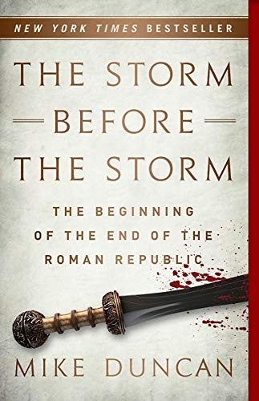

*The Storm Before the Storm* should have just been called *Sulla: A History*.
Mike Duncan covers the decades from 146 BC to Sulla's death in 78 BC, the
stretch where the Roman Republic's norms started breaking long before Caesar
arrived, and while it spends a little time on the Gracchi and enough on Marius
to set the stage, at least half the book belongs to Sulla. That isn't really a
complaint, though. Once Sulla shows up he dominates the period, and I learned a
lot about a man I barely knew going in.

I'm reading Tom Holland's *Rubicon* now, and it probably covers enough of Sulla
to pick up the story of Pompey, Crassus, and Caesar, but what *Storm* gave me
was the grounding. *Rubicon* introduces Marius as a man in his sixties leading
armies in the Social War, shortly before he comes out of retirement and starts
his workout regimen, and without the earlier arc you lose the new man who saved
Rome, held five consecutive consulships, and reorganized the army. Everyone
comments on old Marius training with the young men on the Campus Martius,
desperate for one more command. Coming from *Storm*, that reads as a fall from
grace, but in *Rubicon* it mostly reads as stubbornness.

*Storm* follows Marius all the way back to the war against Jugurtha, the
Numidian king whose defeat made his name, and that showed me how far back the
rivalry between Marius and Sulla goes. It starts at the very beginning of
Marius's career as a general. Sulla, serving under Marius, arranged Jugurtha's
capture and then put the scene on his personal seal ring, which was a brash move
when Marius was the one commanding the army. Those early chapters are the parts
left out of *Rubicon* that I valued most. *Storm* also gives more background on
the Gracchi and a real grounding in the Italian citizenship problem, and its
elaboration on the conditions that led to the Social War made the later story
much easier to follow.

Sulla was the first Roman general to march his army on Rome, and he did it
twice. He used that power and the proscriptions to restore the Senate's
traditional authority, a revolutionary acting in the service of conservatism,
and then he took the dictatorship with no fixed end date, gave it up anyway, and
retired to write his memoirs. It seems like such a bad idea to grab that much
power and then not keep it. His reforms only rolled the clock back a little on
the Senate's decline, and his real legacy was the precedent that an army loyal
to its general could take Rome. Caesar learned that lesson but not the
resignation, and Suetonius has him joking that Sulla didn't know his political
ABCs. Augustus learned both lessons and was far shrewder, keeping the real power
while making a great show of honoring the Senate.

I hate to say it as a Cicero fan, but I suspect a lot of the populares' bad
reputation comes from our conservative sources. Cicero is our richest witness,
and he was firmly on the optimate side. Grain for the poor, land for farmers,
and citizenship for the Italians are all good causes. Granted, some of the men
promising them were after power rather than acting out of good-heartedness, and
Cinna doesn't sound particularly admirable, but I like the Gracchi, and I'm
sorry about how it ended for them.

Anytime debates are decided by armed gangs instead of the truth and strength of
ideas, things have gone badly wrong, and Sulla's purges were the natural,
unfortunate outcome of a politics that had already moved from the Forum to the
battlefield. At least he didn't roll back citizenship and voting rights for the
Italians. Then again, I suspect he would have if he hadn't been forced to give
his word to honor them so he wouldn't have to fight his way back to Rome through
all of Italy, and even with that promise, the Samnites fought him to the end at
the Colline Gate.

If you're planning to read *Rubicon* or anything else on Caesar, *The Storm
Before the Storm* is a worthwhile ten-hour prequel. Duncan's case that the
Republic broke well before Caesar crossed the Rubicon makes the later story make
more sense. I'll cover Holland's trilogy in one post once I finish it.
